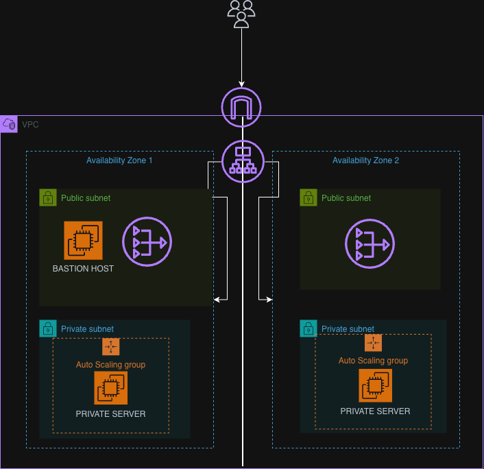

# AWS Two-AZ Web Architecture

A hands-on AWS project implementing a multi-Availability Zone web
architecture with private web servers, an Application Load Balancer,
Auto Scaling Groups, and network security controls.

## Project Overview

The goal of this project was to design, deploy, and validate a web
architecture using core Amazon Web Services (AWS) infrastructure
components.

The architecture includes a custom Virtual Private Cloud (VPC),
public and private subnets across two Availability Zones, an
Internet Gateway, NAT Gateways, a bastion host, private web servers,
and an Application Load Balancer.

The infrastructure was deployed manually through the AWS Management
Console as a hands-on learning exercise.

## Architecture

See [Architecture Details](docs/architecture.md) for a detailed
explanation of the components and traffic flows.

## AWS Services Used

- Amazon Virtual Private Cloud (Amazon VPC)
- Amazon Elastic Compute Cloud (Amazon EC2)
- Amazon Elastic Block Store (Amazon EBS)
- Application Load Balancer
- Amazon EC2 Auto Scaling
- Internet Gateway
- NAT Gateway
- AWS Identity and Access Management (IAM)
- Security Groups
- Route Tables

## Network Design

The project uses a custom VPC with the CIDR block `10.0.0.0/24`.

It contains four subnets distributed across two Availability Zones:

| Subnet | CIDR | Purpose |
|---|---|---|
| Public AZ1 | 10.0.0.0/26 | Public-facing resources |
| Private AZ1 | 10.0.0.64/26 | Private web server |
| Public AZ2 | 10.0.0.128/26 | Public-facing resources |
| Private AZ2 | 10.0.0.192/26 | Private web server |

See [Networking Details](docs/networking.md).

## Security

Security controls include:

- SSH access to the bastion host restricted to the administrator's
  public IP address.
- SSH access to private web servers restricted to the bastion
  security group.
- HTTP access to web servers restricted to the load balancer's
  security group.
- Private web servers without direct public IP access.

See [Security Design](docs/security.md).

## Troubleshooting

During implementation, I encountered a 504 Gateway Timeout while
testing the Application Load Balancer.

I documented the investigation, evidence, root cause, resolution,
and verification in [Troubleshooting](docs/troubleshooting.md).

## Lessons Learned

See [Lessons Learned](docs/lessons-learned.md) for the technical
lessons, design decisions, and improvements identified during the lab.

## Deployment Status

This repository documents a hands-on AWS lab. It is not presented
as a production-certified architecture.

## Cost and Cleanup

AWS resources may incur charges, including EC2 instances, EBS volumes,
NAT Gateways, and load balancers.

See the AWS pricing documentation and verify that lab resources are
removed when no longer needed.

## Future Improvements

- Automate infrastructure provisioning with Terraform.
- Improve deployment reproducibility with EC2 user data.
- Test instance replacement and failure scenarios.
- Evaluate cross-AZ failover behavior.
- Add monitoring and alerting.